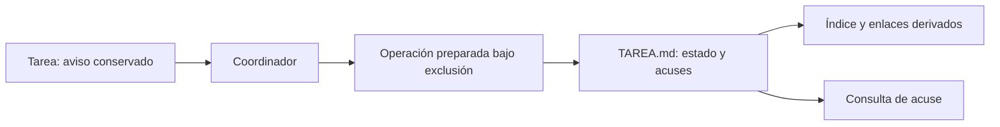

# Almacenamiento de coordinación

## Paradigma

Un único escritor publica documentos completos. Los avisos se conservan antes
del envío y el índice se deriva del registro. Manuel aceptó este diseño de
almacenamiento el 2026-11-14. La implementación y las garantías técnicas siguen
pendientes de validación; los detalles diferidos se fijarán antes de programar.

## Invariantes

### AD-1 — Propiedad [ADOPTED]

- **Binds:** CAP-3, CAP-5, CAP-6.
- **Prevents:** Dos roles alteran el mismo estado o pierden un aviso incierto.
- **Rule:** Solo el coordinador vigente escribe `coordinacion/`. Las tareas
  conservan sus avisos en su entorno y los trasladan por mensajería autorizada o
  manualmente. Las entregas originales siguen perteneciendo a las tareas.

### AD-2 — Unidad de publicación [ADOPTED]

- **Binds:** CAP-3, CAP-6.
- **Prevents:** Estado aplicado sin acuse recuperable por escribir archivos separados.
- **Rule:** Cada `coordinacion/T-001/TAREA.md` contiene identidad, ciclo, revisión
  vigente, estado y acuses por ID de aviso. Cada acuse conserva contenido original
  del aviso, decisión, revisión resultante y referencias. Estado y acuse se publican
  juntos como una versión completa. `ENTREGAS.md` enlaza entregas originales y
  `INDICE.md` enlaza tareas; ambos se pueden reconstruir sin decidir de nuevo estados.
  Los acuses no se purgan automáticamente; se leen selectivamente.
  Cada documento identifica proyecto, tarea, versión de esquema y generación
  creciente de publicación (distinta de la revisión de tarea). El ID de aviso
  es único dentro del proyecto; el ciclo delimita la secuencia de revisiones.
  La igualdad compara todos los campos originales del aviso bajo una única
  serialización versionada, nunca solo ID, fecha o resumen. Los lectores validan
  estructura completa y coherencia; contenido parcial o inválido devuelve incertidumbre.

### AD-3 — Publicación y exclusión [ADOPTED]

- **Binds:** CAP-5, CAP-6.
- **Prevents:** Relevo o procesos auxiliares publican versiones incompatibles.
- **Rule:** Toda mutación adquiere exclusión local de la raíz canónica, verifica
  coordinador vigente y versión actual y conserva una operación preparada: aviso,
  versión base, documento original y documento completo propuesto. Prepara archivos
  fuera del conjunto visible; valida y publica con la primitiva probada para ese
  sistema, preservando el original. Antes de publicar comprueba cambios externos;
  una diferencia detiene la operación. Solo tras releer el resultado completo se
  confirma el registro. La preparación completa, cerrada y validada debe existir
  antes de publicar. Un editor que ignore la exclusión queda fuera de la garantía;
  la edición manual requiere detener los escritores. Un bloqueo abandonado exige
  comprobar propietario y proceso; la antigüedad no autoriza borrarlo.

### AD-4 — Recuperación determinista [ADOPTED]

- **Binds:** CAP-3, CAP-6.
- **Prevents:** Un reinicio vuelve a aplicar un aviso o elige silenciosamente una copia.
- **Rule:** Al reanudar, bajo exclusión, se examinan operaciones preparadas antes
  de nuevas mutaciones. Si el documento coincide íntegramente con la propuesta,
  la operación ya se aplicó; si coincide con la base se puede continuar la misma
  operación tras verificar autoridad y datos. Si no coincide con ninguna, falta
  información o existen varias propuestas incompatibles, se conserva todo y se
  informa para resolver. Un archivo parcial nunca confirma registro. El mismo ID
  con contenido diferente se conserva como conflicto, sin sustituir el original.
  Tras recuperar el canónico se reconstruyen las referencias derivadas.
  Cada operación tiene ID y fases preparada y completada. Se completa solo tras
  verificar estado y acuse juntos. Las completadas no se reproducen en reinicios.
  Si quedó preparada pero existe un documento posterior válido, se comprueba el
  acuse y contenido original: si acredita su incorporación, se completa sin
  restaurar una versión antigua; si no la acredita se conserva como pendiente.
  Las contradicciones se guardan como incidentes con ID propio que referencian el
  aviso original; nunca sustituyen su contenido ni su acuse ya aplicado.

### AD-5 — Alcance operativo [ADOPTED]

- **Binds:** CAP-5, CAP-6.
- **Prevents:** Confundir una prueba local con durabilidad universal.
- **Rule:** Primera validación sobre almacenamiento local de un solo equipo;
  excluir carpetas de red y sincronización entre equipos hasta pruebas específicas.
  No hay servidor permanente. Se comprueba recuperación al retomar o en la revisión
  configurada. El relevo pausa la automatización y confirma inactividad anterior;
  sin exclusividad verificable no se escribe. La vía manual conserva originales,
  publica secuencialmente y declara que no ofrece recuperación automática probada.

## Flujo

## Reutilización y fuentes

Se evaluaron `packages/aikit-installer/src/cli.ts`, `windows-replace.ts` y
`replace-recovery.ts`: ofrecen patrones de exclusión, temporales, respaldo y
diagnóstico conservador; no son todavía un motor de transacciones de coordinación.
No se fija runtime. Si se reutiliza Node.js, la referencia consultada es 22.23.4:
[API fs oficial](https://github.com/nodejs/node/blob/v22.23.4/doc/api/fs.md).
La exclusión puede no funcionar en sistemas de red; el flush depende del sistema
y dispositivo. La publicación y durabilidad deben probarse, no deducirse del nombre
de una primitiva.

## Verificación antes de implementar en proyectos reales

- Fallo antes, durante y después de publicar: recuperar base o propuesta completas,
  sin acuse positivo de contenido parcial.
- Mismo aviso repetido, antiguo o contradictorio: decisiones identificables y
  conservación de la revisión correcta tras reiniciar.
- Dos escritores y relevo: solo uno publica; bloqueo incierto conserva los datos.
- Índice perdido o desactualizado: reconstrucción desde documentos canónicos.
- Windows, Linux y macOS: validar por separado sustitución, exclusión y fallos;
  no declarar resistencia a apagones sin evidencia del sistema y almacenamiento.

## Diferido

El [contrato técnico v1](almacenamiento-v1.md) concreta como propuesta para revisión
el esquema Markdown/JSON, IDs, operaciones, Node.js y primitivas por plataforma.
Sus elecciones nuevas no se consideran aceptadas por las aprobaciones previas.
La compactación de acuses
requiere preservar deduplicación e historial; no se incluye en la primera versión.
La integración Git, los títulos y el archivado siguen el contrato general y no
dependen de que se implemente este almacenamiento concreto.
